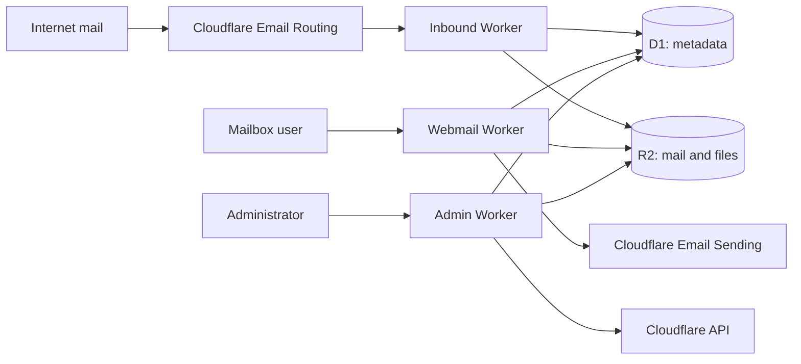

# BeeCloudMail

Real mailboxes for all the domains in your Cloudflare account, with webmail and an admin panel. No servers to run: everything runs on Cloudflare Workers, D1 and R2.

> **Early project.** The test suite and a local end-to-end smoke test pass, but sending and receiving real mail through a production mailbox has not been fully verified yet. Don't make this your only mailbox for now. Reports from real deployments are very welcome.

## Why this project

BeeCloudMail was built for running several online stores. Each domain needs only a few mailboxes: one to support customers, others to sign up for store, payment and bank accounts.

Email forwarding handles the receiving, but when a customer has a problem with an order, you need to answer from the store's own address. BeeCloudMail gives each of those addresses a real inbox that can reply, all from one place:

- **Domain onboarding from the panel.** Discover your domains, check DNS, and enable email. If a domain already receives mail through another provider, onboarding stops and shows the conflicting MX records instead of replacing them.
- **Separate mailboxes.** Each mailbox has its own login, messages and files. Tests cover access between mailboxes.
- **Careful with untrusted mail.** HTML renders in a sandboxed iframe with no scripts, and remote images stay blocked until you choose to load them.
- **Careful when sending.** A repeated send attempt can't send a second copy, and an unknown result is reported as unknown rather than retried.
- **Small.** Plain JavaScript, no frontend framework or frontend build step, two runtime dependencies.

## What it does

**Webmail:** sign in with your full email address; inbox, sent and trash; search; HTML and plain-text reading; reply with quoted content; attachments; download the original EML.

**Admin panel:** sync domains; check and enable email; create mailboxes and retry incomplete ones; reset passwords; suspend, forward and delete mailboxes; view the audit log.

**Not available yet:** Cc/Bcc, reply all, drafts, threaded view, spam filtering, permanent delete, IMAP/POP3, changing your own password, 2FA or passkeys, and inline (CID) images in older messages.

## How it works



The Cloudflare API token is available only to the Admin Worker. Only the Webmail Worker can send mail.

## Costs and requirements

- A Cloudflare account, with your domains using Cloudflare DNS.
- **Workers Paid is required to send to any recipient.** It includes 3,000 emails per month, then $0.35 per 1,000. Receiving through Email Routing is available on the free plan. See [Cloudflare's pricing](https://developers.cloudflare.com/email-service/platform/pricing/) for current details.
- [Email Sending](https://developers.cloudflare.com/email-service/) is in beta and Cloudflare presents it as a transactional email service. Limits and terms may change, so check that it suits your use.
- Node.js 24 or newer.

## Try it locally

No Cloudflare account needed. The demo uses local storage and simulated Cloudflare responses, and sends no mail.

```bash
npm ci
npm run db:local
npm run seed:local
npm run dev
```

|         |                              |                                      |
| ------- | ---------------------------- | ------------------------------------ |
| Panel   | http://127.0.0.1:8788/panel/ | `admin` / `local-demo-only-2026`     |
| Webmail | http://127.0.0.1:8788/       | Created by the smoke test, see below |

With the dev server running, `npm run smoke:local` creates two demo mailboxes, delivers a sample message and checks access control. You can then sign in as `hello@studio.example` or `support@games.example`, with the same password.

The demo password is public, so it must never be used on a real deployment.

## Deploy

**1. Create the resources**

```bash
npx wrangler login
```

```bash
npx wrangler d1 create beecloudmail
```

```bash
npx wrangler r2 bucket create beecloudmail
```

**2. Generate your configuration**

The apps are served from `mail.<domain>` and `panel.<domain>`. Make sure neither hostname is already in use. The generated `wrangler.*.jsonc` files are ignored by git.

```bash
npm run init-config -- --account-id <account-id> --database-id <database-id> --domain <domain>
```

**3. Create the tables and deploy the Workers**

```bash
npx wrangler d1 migrations apply DB --remote -c wrangler.webmail.jsonc
```

```bash
npx wrangler deploy -c wrangler.inbound.jsonc
```

```bash
npx wrangler deploy -c wrangler.webmail.jsonc
```

```bash
npx wrangler deploy -c wrangler.admin.jsonc
```

**4. Set the administrator password**

This opens a setup page on your own machine. It stores only a password hash, and it won't replace an existing administrator.

```bash
npm run set-admin
```

**5. Connect the panel to Cloudflare**

This opens a local page listing the token permissions to grant. Limit the token to your account and to the domains the panel should manage, and don't use a Global API Key. The token is checked, then stored as a secret on the Admin Worker.

```bash
npm run set-token
```

**6. Add your first mailbox**

Sign in to `https://panel.<domain>/`, choose **Sync domains**, enable email on a domain, and create a mailbox. Then sign in at `https://mail.<domain>/` and send yourself a test in both directions.

We recommend also putting the panel behind [Cloudflare Access](https://developers.cloudflare.com/cloudflare-one/applications/), because it has a single administrator and no 2FA yet.

## Good to know

- **Sign-in limits:** 10 failed attempts per IP and 50 per account in 15 minutes. Someone deliberately failing sign-ins from many IPs can temporarily block one account, but not others.
- **Sender shown:** the inbox shows the address in the `From` header. If the delivering domain differs, the reader shows `via <domain>`. A `via` you don't expect can be a sign of a forged sender.
- **Forwarding:** destinations must be verified in Cloudflare first. Messages are saved before forwarding, so a failed forward doesn't lose mail, and the reader shows a warning.
- **Storage:** messages in Trash are kept, and nothing is deleted automatically. Deleting a mailbox removes its messages and files.
- **Size limits:** incoming messages up to 25 MB; outgoing attachments up to 2.5 MB in total.

## Development

```bash
npm run check
```

```bash
npm run format
```

```bash
npm run build
```

`npm run check` runs syntax checks and the tests. `npm run build` bundles all three Workers without publishing them.

See [CONTRIBUTING.md](CONTRIBUTING.md) to get involved, and [SECURITY.md](SECURITY.md) to report a vulnerability.

## License

[MIT](LICENSE)
